<div align="center">

<a href="https://git.io/typing-svg">
</a>

<br/>


<br/>

[](https://github.com/T9-source)
[](https://github.com/T9-source?tab=followers)
[](https://github.com/T9-source?tab=repositories)
[](#-lets-connect)

</div>

---

## 🌊 Spotlight — Aether (Flagship)

<div align="center">

**Local-first, open-source API security proxy.** Intercept, inspect, replay
and rewrite HTTP/1 · HTTP/2 · WebSocket traffic — a Rust engine built for
speed, a virtualized console that stays fast at 100k+ flows, and **zero
telemetry, ever**.

[](https://github.com/T9-source/aether/releases)


[](https://github.com/T9-source/aether/actions/workflows/ci.yml)
[](https://github.com/T9-source/aether/actions/workflows/codeql.yml)
[](https://api.scorecard.dev/projects/github.com/T9-source/aether)

</div>

- 🔐 **TLS MITM done right** — rustls + rcgen CA, wire-truth preserving codec
- ⚡ **100k flows without breaking a sweat** — SQLite WAL + FTS5 search (~0.5ms pages), benchmarked in CI with performance budgets
- 🧩 **Sandboxed WASM plugin host (V0.3)** — fail-closed `plugin.toml` manifests, capability vocabulary, checksum pinning — plugins edit, never execute
- 🤖 **MCP built-in** — your local AI assistant (Claude Desktop, VS Code) queries your captured flows over MCP — read-only by default, fully offline
- 🛡️ **Hardened like a security product should be** — fuzzed parsers, CodeQL, SHA-pinned CI, OpenSSF Scorecard, coordinated disclosure policy

<div align="center">

| Intercept | History | Viewer | Connect |
|---|---|---|---|
| 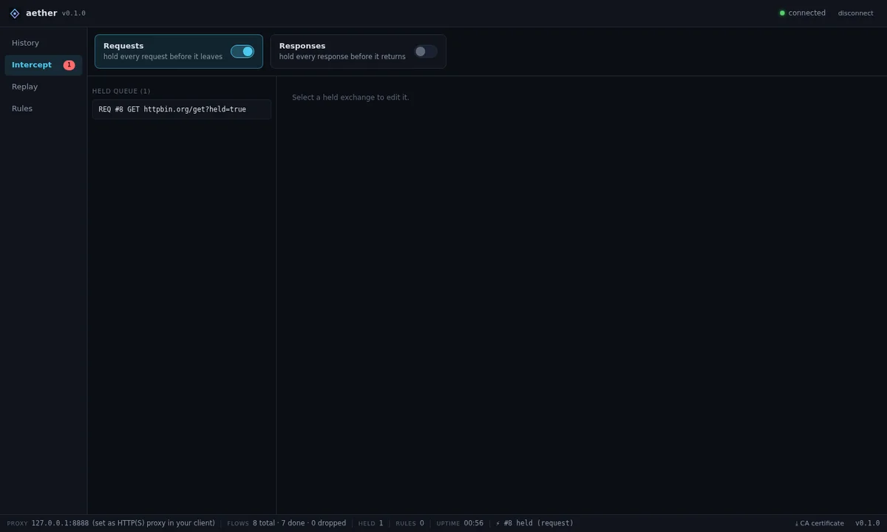 | 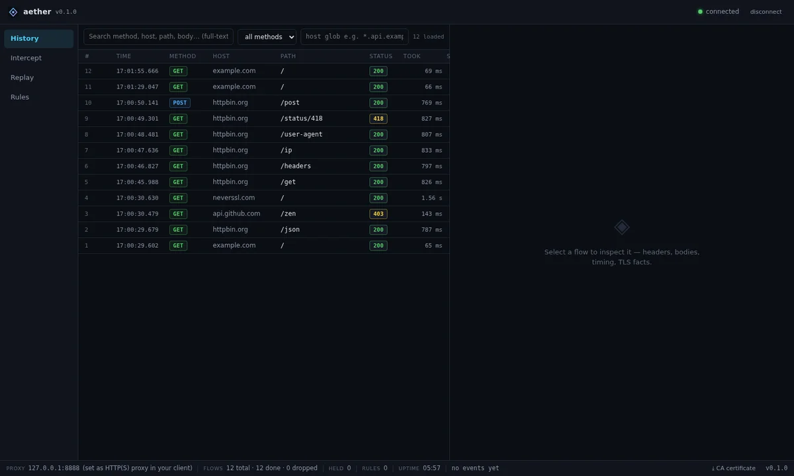 | 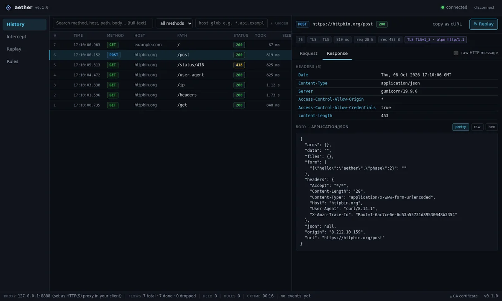 | 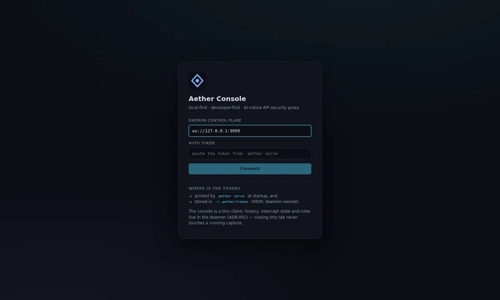 |

</div>

```bash
# 1) grab a release binary — macOS (arm64/x64) · Linux (musl static) · Windows
#    https://github.com/T9-source/aether/releases/latest
# 2) or run from source:
cargo run -p aether-cli -- serve --memory   # up in 30 seconds
```

> **Why not mitmproxy or Burp?** Every flow lands in **local SQLite your AI can
> search over MCP** — mitmproxy keeps flows in RAM (their own tracker, open
> since 2017), Burp AI is cloud-only, Reqable is closed-source. Full
> vendor-sourced comparison → [docs/comparison.md](https://github.com/T9-source/aether/blob/main/docs/comparison.md)

📌 **Repo:** [T9-source/aether](https://github.com/T9-source/aether) ·
[Release 0.2.1](https://github.com/T9-source/aether/releases/tag/0.2.1) ·
Roadmap: WASM plugin host ✓ → query language → AI layer (BYO-key, off by default)

---

## 💫 About Me

- 🔐 **Penetration Tester** — web application pentesting, network security & vulnerability assessment
- 💻 **Full-Stack Developer** — management systems, e-commerce stores, dashboards & web design
- ⚙️ **Computer Engineer** — I build it, I break it, then I secure it
- 🌍 Working with clients worldwide — open for remote projects & collaborations

---

## ⭐ Security Flagship — CloudFail-Killer (CloudKill)

<div align="center">

### 🔓 [CloudKill — Origin IP Discovery](https://github.com/T9-source/cloudfail-killer)

**Multi-source, IPv6-native reconnaissance** that finds origin
servers hidden behind Cloudflare — 15+ passive & active data sources, a 7-stage enrichment
pipeline, and confidence-scored results. Built for pentesters & bug bounty hunters.

[](https://github.com/T9-source/cloudfail-killer)
[](https://pypi.org/project/cloudkill/)
[](https://github.com/T9-source/cloudfail-killer)
[](https://github.com/T9-source/cloudfail-killer)
[](https://github.com/T9-source/cloudfail-killer)
[](https://github.com/T9-source/cloudfail-killer)

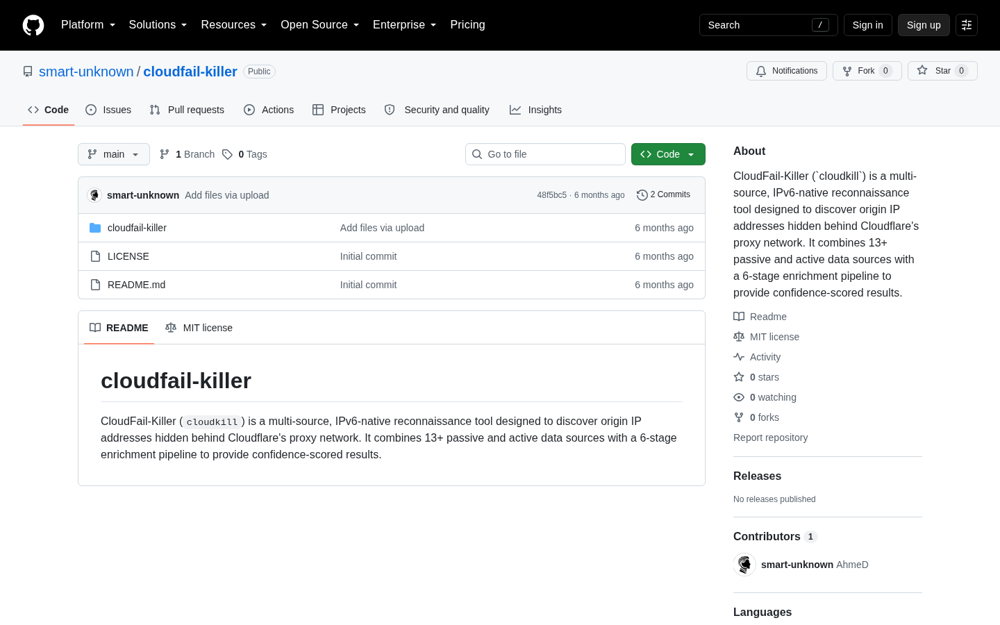

`crt.sh` · `Shodan` · `Censys` · `Wayback` · `URLScan` · `DNSDumpster` · `GitHub Dorking` · signed reports (ed25519) · plugin sources · CI mode

</div>

---

## 🌐 Live Systems

<div align="center">

| ✦ | System | Stack |
|---|---|---|
| 🍳 | **[Gadgeta — Magic & Innovation](https://gadgate.vercel.app)** | Next.js 16 · Prisma · Neon Postgres |
| 👞 | **[Yalla Shiaka — Shoes Store](https://yallashiaka.vercel.app)** | Next.js 16 · Prisma · Admin & Supervisors |
| 🔧 | **[Noor Center — Maintenance System](https://noorcenter.gt.tc)** | Laravel · MySQL · Role-based |
| 🛵 | **[اطلبني — Zone Delivery App](https://otlobny-chi.vercel.app)** | Android APK · Web App · Admin Panel · V2 |
| 💼 | **[My Portfolio](https://jemyv2.vercel.app)** | Next.js 16 · React 19 · bilingual & dark-first |

</div>

---

## 🛵 Spotlight — اطلبني (Latest Release)

<div align="center">


**📱 امسح الكود واطلب من المنيب فوراً**

**أول زون-ابليكيشن في مصر** — منصة توصيل مخصوصة لمنطقة المنيب بالكامل:
مطاعم بتدير منيوهاتها بنفسها + أي طلبات يومية (سوبر ماركت · صيدلية · مشاوير) + كباتن من أهل المنطقة بإسناد لحظي + لوحة تحكم كاملة — **بصفر تكاليف سيرفر**.

[](https://otlobny-chi.vercel.app)
[](https://otlobny-chi.vercel.app)
[](https://otlobny-chi.vercel.app)
[](https://otlobny-chi.vercel.app/)

| تطبيق أندرويد | لوحة تحكم الإدارة | طلب أونلاين |
|---|---|---|
| 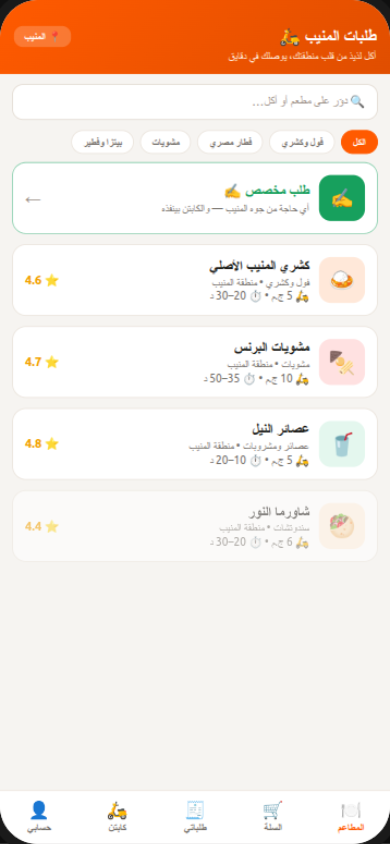 | 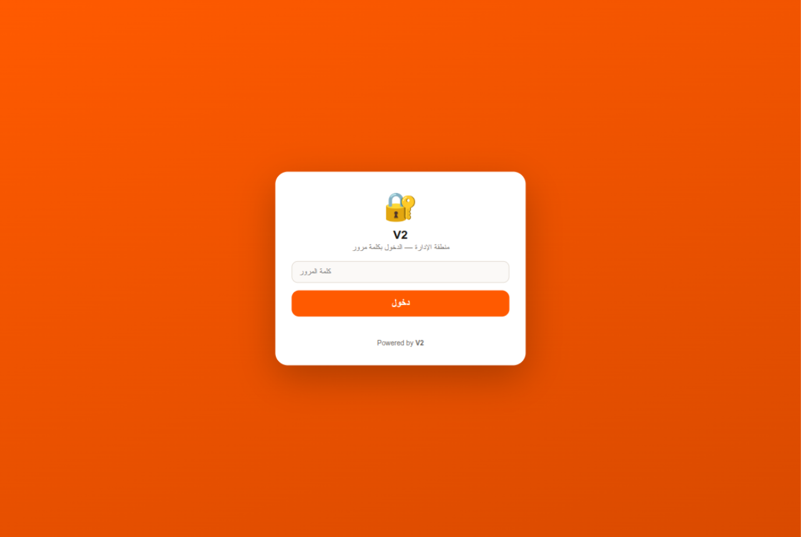 | 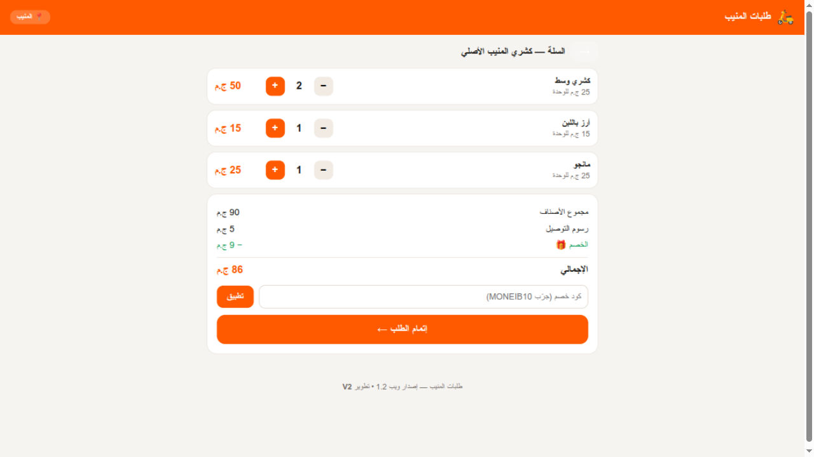 |

**جديد v2.1:** بوابة أصحاب المطاعم (كل مطعم يدير منيوه وأسعاره وصور أصنافه من التطبيق) · إسناد الأوردرات للكباتن بمهلة قبول 30 ثانية وإعادة توجيه تلقائية · تصعيد واتساب تلقائي للإدارة بعد 5 دقايق من غير استلام · أرشفة شهرية تحافظ على البيانات مهما كبرت.

**تجربة كاملة لايف:** تطبيق أندرويد + موقع طلب + لوحة إدارة + نظام كباتن معتمدين — شغالة على منطقة حقيقية، والبنية جاهزة للتوسع لمناطق جديدة.

</div>

---

## 🚀 Featured Projects

| Project | About |
|---|---|
| 🌊 **[Aether](https://github.com/T9-source/aether)** → [**v0.2.1**](https://github.com/T9-source/aether/releases/tag/0.2.1) | **Flagship** API security proxy in Rust — MITM h1/h2/WS · 100k-flow console · sandboxed WASM plugin host · MCP for local AI · fuzzed + Scorecard-hardened · zero telemetry |
| 🔓 **[CloudFail-Killer (CloudKill)](https://github.com/T9-source/cloudfail-killer)** → [**PyPI**](https://pypi.org/project/cloudkill/) | **Flagship security tool** — origin-IP discovery behind Cloudflare · 15+ sources · 343 tests · SARIF & signed reports |
| 🛵 **[Otlobny — اطلبني](https://otlobny-chi.vercel.app)** → [**LIVE**](https://otlobny-chi.vercel.app/) | 🚀 Zone-locked delivery platform — Android (native Java) · Web · Admin dashboard · Restaurant self-service portal · 30s live dispatch · 0 security findings |
| 🔧 **[Noor Center](https://noorcenter.gt.tc)** → [**LIVE**](https://noorcenter.gt.tc) | 🔧 Maintenance-center management system — Laravel · MySQL · roles |
| 🍳 **[Gadgeta Store](https://gadgate.vercel.app)** → [**LIVE**](https://gadgate.vercel.app) | 🍳 Magic & Innovation e-commerce — golden deals · coupons · Neon Postgres |
| 👞 **[Yalla Shiaka Store](https://yallashiaka.vercel.app)** → [**LIVE**](https://yallashiaka.vercel.app) | 🥾 E-commerce with admin & supervisor dashboards — Next.js · Prisma |
| [**Cinematic Landings**](https://github.com/T9-source/monolith-landing) | ⬡ MONOLITH · OBLIVION · ECHO · NOVA — WebGL experiences, zero build |
| 💼 **[Portfolio Website](https://jemyv2.vercel.app)** → [**LIVE**](https://jemyv2.vercel.app) | 💼 Bilingual (AR/EN) portfolio — Next.js 16 · React 19 · dark-first · live GitHub dashboard |

---

## 🛡️ Cybersecurity Arsenal

<div align="center">

[](https://www.kali.org/)
[](https://portswigger.net/burp)
[](https://nmap.org/)
[](https://www.metasploit.com/)
[](https://www.wireshark.org/)
[](https://www.zaproxy.org/)
[](https://sqlmap.org/)
[](https://github.com/vanhauser-thc/thc-hydra)
[](https://hashcat.net/hashcat/)
[](https://www.tenable.com/products/nessus)
[](https://www.aircrack-ng.org/)

</div>

---

## 💻 Tech Stack

<div align="center">

**Frontend & UI**

<a href="https://skillicons.dev"></a>

**Backend & Databases**

<a href="https://skillicons.dev"></a>

**Tools & DevOps**

<a href="https://skillicons.dev"></a>

**Mobile & Delivery**

<a href="https://skillicons.dev"></a>

</div>

---

## 📊 GitHub Stats

<div align="center">


<br/>

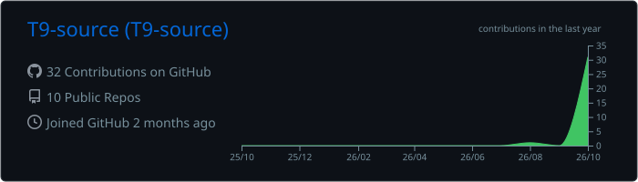
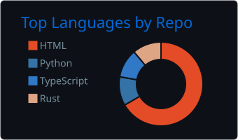

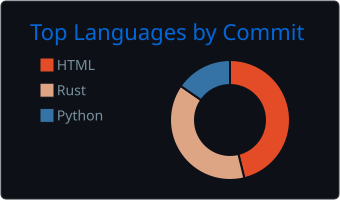
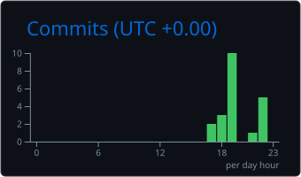

<sub>🔄 self-rendered daily by GitHub Actions — never rate-limited</sub>

</div>

---

## 🏆 Achievements

<div align="center">

[](https://github.com/T9-source?tab=repositories)
[](https://github.com/T9-source?tab=repositories)
[](https://github.com/T9-source/aether/releases)
[](https://pypi.org/project/cloudkill/)
[🛵 OTLOBNY v2.1 LIVE](https://img.shields.io/badge/🛵-OTLOBNY_v2.1_LIVE-0098B0?style=for-the-badge&labelColor=0d1117)
[](https://github.com/T9-source/cloudfail-killer)
[](https://otlobny-chi.vercel.app)

</div>

---

## 🤝 Let's Connect

<div align="center">

[](https://github.com/T9-source)
[](mailto:ntgi46@proton.me)
[](https://wa.me/201148252590)

**Open for** pentest engagements 🔐 • full-stack builds 💻 • collaborations 🤝

*Find a vulnerability in my code? Congrats — you passed the first test.* 😏


</div>

---

<picture>
  <source media="(prefers-color-scheme: dark)" srcset="https://raw.githubusercontent.com/T9-source/T9-source/output/github-snake-dark.svg">
  <source media="(prefers-color-scheme: light)" srcset="https://raw.githubusercontent.com/T9-source/T9-source/output/github-snake.svg">
  
</picture>
